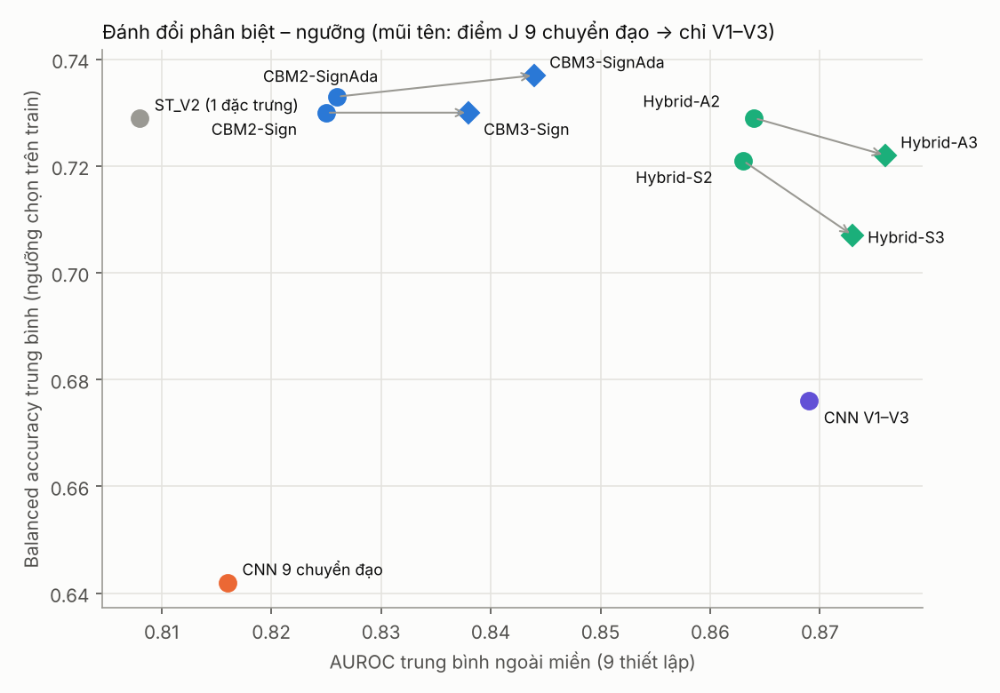
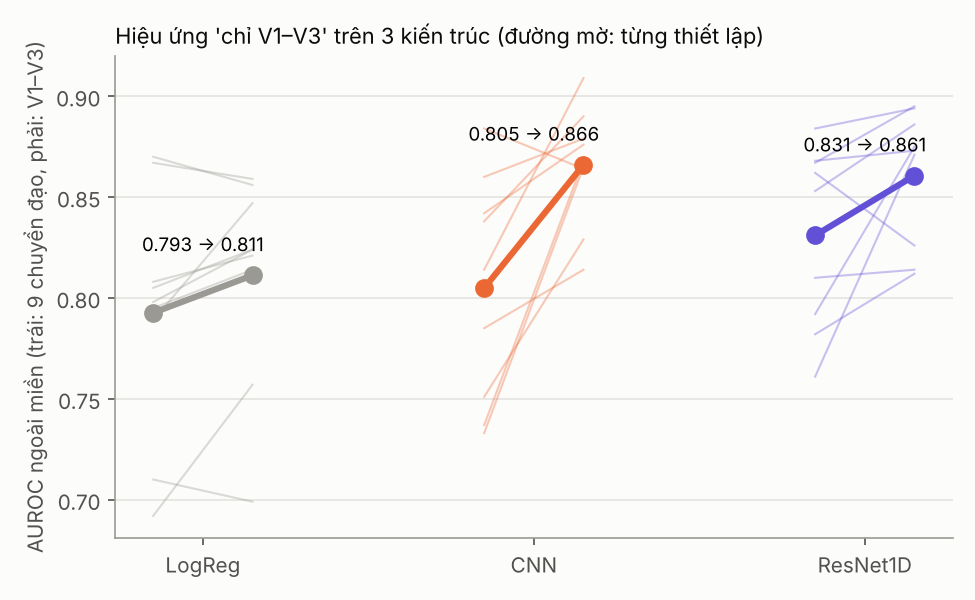
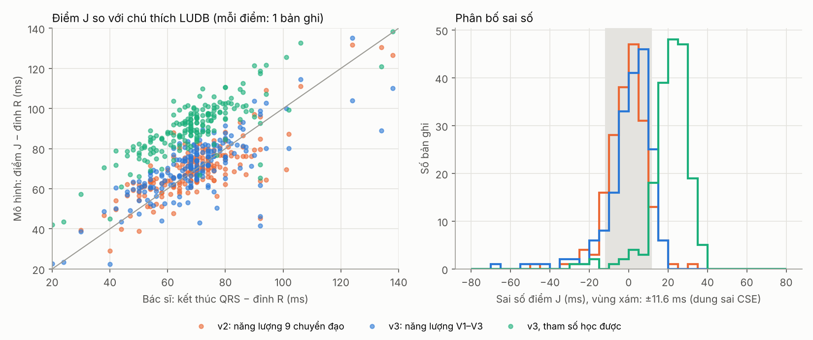

# Bước 4: điểm J chỉ từ V1–V3, Hybrid không thích nghi, độ bền theo kiến trúc, kiểm chứng điểm J trên LUDB

Bốn câu hỏi còn treo sau bước 3:
1. Tính điểm J và `QRS_w` chỉ từ V1–V3 (thay vì cả 9 chuyển đạo) có làm mô hình khái niệm chuyển miền tốt hơn không?
2. Hybrid không dùng Ada (dùng được cho sàng lọc tỉ lệ bệnh thấp) có giữ được ưu điểm không?
3. Hiệu ứng "chỉ V1–V3" có đúng với kiến trúc khác ngoài CNN đã dùng không?
4. Điểm J mà lớp khái niệm tìm ra có khớp với điểm J do bác sĩ đánh dấu không? (LUDB)

## 1. Khái niệm v3: điểm J và QRS_w chỉ từ V1–V3 (`concepts3.py`, `compare_v4.py`)

`concepts3.py` giống `concepts2.py`, chỉ khác một dòng: năng lượng đạo hàm dùng để tìm điểm J và `QRS_w` lấy từ V1, V2, V3 thay vì cả 9 chuyển đạo. Kiểm tra phantom vẫn đạt:
- Bất biến affine theo từng chuyển đạo: sai khác cỡ 1e-5.
- J_elev V2 tương quan Spearman 0.98 / 0.94 / 0.93 với giá trị thật trên 3 mức nhiễu.
- Corrado V2 phân biệt dạng vòm với dạng yên ngựa: AUC 0.88–0.98.

**Kết quả (9 thiết lập ngoài miền, 3 seed validation, AUROC tính trên điểm trung bình 3 seed):**

| Mô hình | AUROC TB | Balanced acc TB | Balanced acc thấp nhất |
|---|---|---|---|
| ST_V2 (1 đặc trưng, quy tắc) | 0.808 | 0.729 | **0.702** |
| CNN 9 chuyển đạo | 0.816 | 0.642 | 0.572 |
| CBM2-Sign | 0.825 | 0.730 | 0.665 |
| CBM2-SignAda | 0.826 | 0.733 | 0.641 |
| **CBM3-Sign** | **0.838** | 0.730 | 0.653 |
| **CBM3-SignAda** | **0.844** | **0.737** | 0.682 |
| CNN V1–V3 | 0.869 | 0.676 | 0.530 |
| Hybrid-S2 (CNN V1–V3 + CBM2-Sign) | 0.863 | 0.721 | 0.643 |
| Hybrid-A2 (CNN V1–V3 + CBM2-SignAda) | 0.864 | 0.729 | 0.640 |
| Hybrid-S3 (CNN V1–V3 + CBM3-Sign) | 0.873 | 0.707 | 0.578 |
| **Hybrid-A3** (CNN V1–V3 + CBM3-SignAda) | **0.876** | 0.722 | 0.595 |

**So sánh cặp (bootstrap ghép cặp, Holm trên 9 thiết lập):**

| So sánh | Thắng | Hòa | Thua |
|---|---|---|---|
| CBM3-Sign với CBM2-Sign | 4 | 5 | 0 |
| CBM3-SignAda với CBM2-Sign | 3 | 6 | 0 |
| CBM3-Sign với CNN V1–V3 | 0 | 6 | 3 |
| Hybrid-S3 với CNN V1–V3 | 0 | 9 | 0 |
| Hybrid-A3 với CNN V1–V3 | 0 | 9 | 0 |
| Hybrid-S3 với CNN 9 chuyển đạo | 6 | 3 | 0 |
| Hybrid-A3 với CNN 9 chuyển đạo | 5 | 4 | 0 |

**Đọc kết quả:**
- **Điểm J từ V1–V3 tăng AUROC của mô hình khái niệm** (0.825 → 0.838, thắng 4/9, không thua). Mức tăng rõ nhất khi HUCA là miền huấn luyện hoặc miền test (HUCA → Mortara 0.781 → 0.808, Claris + Mortara → HUCA 0.869 → 0.901).
- **Nhưng không giải quyết được Mortara khi huấn luyện LODO:** HUCA + Claris → Mortara 0.802 → 0.800.
- **Giả thuyết "QRS_w là thủ phạm" chỉ đúng một phần** (`shift_v4.py`, `shift_v4.json`). Ở nhóm âm tính, dịch chuyển của `QRS_w` (SMD):

  | Cặp miền | v2 (9 chuyển đạo) | v3 (V1–V3) |
  |---|---|---|
  | Claris → Mortara | −0.98 | **−0.48** |
  | HUCA → Claris | +0.90 | −0.93 |
  | HUCA → Mortara | −0.18 | **−1.41** |

  Dịch chuyển Claris → Mortara giảm một nửa, nhưng HUCA → Mortara lại tăng mạnh. `QRS_w` vẫn là khái niệm nhạy với máy đo nhất, dù tính từ chuyển đạo nào. Hướng xử lý tiếp: bỏ hẳn `QRS_w` khỏi đầu ra, hoặc chỉ giữ nó làm mốc thời gian.
- **Ngưỡng của khái niệm v3 kém bền hơn khi chuyển sang HUCA.** Claris → HUCA: CBM2-Sign có balanced accuracy 0.771, còn CBM3-Sign chỉ 0.653 (độ đặc hiệu 0.33). AUROC tăng nhưng điểm số bị lệch lên ở HUCA. Đây là lý do balanced accuracy trung bình của CBM3 không tăng theo AUROC.
- **Hybrid không thích nghi (S2/S3) vẫn ngang CNN V1–V3 ở 9/9 thiết lập**, và thắng CNN 9 chuyển đạo ở 6/9. Tuy vậy, balanced accuracy của Hybrid-S3 (0.707) thấp hơn Hybrid-A2 (0.729). Phần CNN kéo ngưỡng lệch theo hướng có hệ thống:
  - Melo → HUCA: điểm bị đẩy lên, độ nhạy gần 1, độ đặc hiệu 0.06–0.38.
  - HUCA → Melo: điểm bị kéo xuống, độ nhạy 0.16–0.49.

  Đây là lệch hiệu chuẩn giữa HUCA (tín hiệu thô 12 giây, 100 Hz) và Melo (nhịp trung vị do máy tính sẵn). Nó không phải lỗi của riêng mô hình nào.
- **Một quy tắc 1 đặc trưng (ST_V2) vẫn có ngưỡng ổn định nhất** (balanced accuracy thấp nhất 0.702), nhưng AUROC thấp nhất. Bài báo nên báo cáo trung thực điều này.



## 2. Hiệu ứng "chỉ V1–V3" qua 3 kiến trúc (`arch_v4.py`)

Seed validation 0. ResNet là ensemble 3 seed. LogReg chạy trên tín hiệu thô, chọn C bằng CV trong tập train.

| Kiến trúc | 9 chuyển đạo | Chỉ V1–V3 | Số thiết lập V1–V3 tốt hơn |
|---|---|---|---|
| LogReg (tuyến tính) | 0.793 | 0.811 | 6/9 |
| CNN (như các bước trước) | 0.805 | 0.866 | 8/9 |
| ResNet1D (3 khối residual) | 0.831 | 0.861 | 8/9 |

**Hiệu ứng không phụ thuộc vào một CNN cụ thể.** Giới hạn đầu vào vào V1–V3 tăng AUROC ngoài miền ở cả ba kiến trúc. Mức tăng lớn nhất ở mô hình phi tuyến, vì mô hình phi tuyến khai thác các chuyển đạo ngoài V1–V3 mạnh hơn. Ví dụ rõ nhất:
- Mortara → Claris, ResNet: 0.792 → 0.875.
- HUCA + Mortara → Claris, ResNet: 0.761 → 0.871.



## 3. Kiểm chứng điểm J trên LUDB (`ludb_validate.py`)

**Dữ liệu:** LUDB, 200 bản ghi 10 giây, 500 Hz. Bác sĩ tim mạch đánh dấu điểm bắt đầu, đỉnh và kết thúc QRS cho từng nhịp. Có 9 bản ghi có máy tạo nhịp, báo cáo riêng.

**Cách làm:**
- Mô hình không thấy chú thích. Tín hiệu đi qua đúng quy trình `harmonize.py`: lọc 0.5–40 Hz, hạ về 100 Hz, nhịp trung vị 75 mẫu.
- Điểm J được quy đổi về thời gian tuyệt đối của từng nhịp, rồi so với điểm kết thúc QRS trên chuyển đạo V2 do bác sĩ đánh dấu.
- Sai số của một bản ghi là trung vị theo nhịp.

**Kết quả trên 191 bản ghi không có máy tạo nhịp (đơn vị ms):**

| Biến thể | Độ lệch | SD | MAE | Trong ±10 ms | Trong ±20 ms |
|---|---|---|---|---|---|
| **v2, tham số khởi tạo** (năng lượng 9 chuyển đạo) | **−0.6** | **9.8** | **7.1** | 75% | 95% |
| v2, ngưỡng cứng (không làm mềm) | +0.6 | 9.8 | 7.3 | 80% | 96% |
| v3, tham số khởi tạo (năng lượng V1–V3) | 0.0 | 15.0 | 9.0 | 71% | 95% |
| v3, ngưỡng cứng | +1.7 | 16.2 | 9.4 | 74% | 95% |
| v2, tham số học được | +19.3 | 8.9 | 19.6 | 12% | 52% |
| v3, tham số học được | +20.6 | 12.4 | 22.5 | 5% | 36% |

**Theo nhóm** (v2 khởi tạo / v3 khởi tạo, SD tính bằng ms):

| Nhóm | Số bản ghi | Độ lệch v2 | SD v2 | Độ lệch v3 | SD v3 |
|---|---|---|---|---|---|
| Dẫn truyền bình thường | 130 | −0.8 | 7.4 | +2.2 | 7.7 |
| Có rối loạn dẫn truyền | 61 | 0.0 | 13.6 | −4.5 | 23.6 |
| RBBB (hoàn toàn hoặc không hoàn toàn) | 33 | −2.3 | 15.2 | −3.5 | 25.6 |
| LBBB | 10 | +2.8 | 13.6 | −14.8 | 26.5 |

**Đọc kết quả:**
1. **Điểm J khả vi, chưa học, khớp với bác sĩ.**
   - Độ lệch gần 0, SD 9.8 ms. Ngưỡng dung sai thường dùng cho kết thúc QRS là SD ≤ 11.6 ms (2σ_CSE). Ở nhóm dẫn truyền bình thường, SD chỉ 7.4 ms.
   - Kết quả này đạt được dù tín hiệu chỉ có 100 Hz (bước mẫu 10 ms).
   - Phiên bản mềm cho kết quả gần như hệt phiên bản cứng. Nghĩa là việc làm mềm để lan truyền gradient không làm lệch phép đo.
2. **Điểm J từ V1–V3 kém chính xác hơn khi có rối loạn dẫn truyền** (SD 23.6 so với 13.6 ms; LBBB lệch −15 ms). Ở RBBB/LBBB, QRS ở V1–V3 kết thúc sớm hoặc muộn hơn QRS toàn cục, mà bác sĩ đánh dấu kết thúc QRS dựa trên toàn bộ ECG. Vậy v3 đổi độ chính xác giải phẫu lấy độ bền khi chuyển miền: AUROC tăng ở mục 1, nhưng điểm J kém hơn trên ECG có rối loạn dẫn truyền.
3. **Khi học trên dữ liệu Brugada, mô hình tự dời điểm đo J về khoảng J + 20 ms.** Điều này nhất quán qua 2 seed và cả v2 lẫn v3. Các tham số học được (`ludb_J_meta.json`):
   - Ngưỡng θ giảm từ 0.15 xuống 0.087.
   - Lệch J +13.5 ms.
   - Nền dời từ −80 ms về −100 ms trước đỉnh QRS, tức vào đoạn PR đẳng điện.
   - Vị trí đo ST tăng từ 80 lên 90 ms.

   Không tham số nào chạm biên. Đây là **một tham số giải thích được và kiểm chứng được bằng dữ liệu độc lập**: mô hình "chọn" đo độ chênh ST ở đầu đoạn ST thay vì đúng tại điểm J. Ở ECG có RBBB hoặc Brugada, điểm J khó xác định, và đầu đoạn ST là nơi các khuyến cáo đo ST thường dùng (J+20 đến J+60 ms). Lưu ý: vì thế khái niệm "J_elev" của mô hình đã học nên gọi là "độ chênh đầu đoạn ST", không phải "độ chênh tại J" theo đúng nghĩa đen.
4. **Điểm "cất cánh" của V2 (nơi đo J_elev) nằm sau điểm J khoảng 40 ms ở ECG bình thường.** Đây là do định nghĩa: điểm cất cánh là đỉnh của (tín hiệu − nền) trong cửa sổ [J − 10, J + 50] ms. Ở V2 bình thường, đoạn ST đi lên dần về sóng T, nên đỉnh rơi về cuối cửa sổ. Với Brugada type 1, đỉnh rơi gần J. Cần mô tả rõ điều này trong bài báo.
5. **`QRS_w` tương quan vừa phải với độ rộng QRS do bác sĩ đo** (Spearman 0.37–0.38). `QRS_w` là số mẫu năng lượng vượt 30% đỉnh, không phải phép đo độ rộng QRS. Không nên gọi nó là "độ rộng QRS" trong bài báo.



**Chạy lại trên bản LUDB tải về máy (13/10/2026):**
- Bản của bạn ở `D:\...\lobachevsky-university-electrocardiography-database-1.0.1`. Đã chạy lại `ludb_validate.py` trên bản ghi 1–160 (máy mất kết nối giữa chừng nên 161–200 chưa chép được).
- Sai số từng bản ghi **trùng hoàn toàn** với lần chạy trước, chênh tối đa 0.0 ms cho mọi biến thể, kể cả các biến thể học được. Vậy dữ liệu và kết quả tái lập được.
- Trên tập con 151 bản ghi không có máy tạo nhịp:
  - v2 khởi tạo: độ lệch 0.0 ms, SD 10.2 ms, 75% trong ±10 ms.
  - v2 học được: +20.0 ms.
  - v3 học được: +20.6 ms.
- Kết luận ở trên không đổi. Kết quả nằm trong `ludb_user160/`.

## Tổng kết bước 4 và câu chuyện bài báo

1. **Đóng góp chắc chắn nhất là hiện tượng shortcut ngoài V1–V3.** Nó đúng với 3 kiến trúc (tuyến tính, CNN, ResNet), và ràng buộc đầu vào theo sinh lý tăng AUROC ngoài miền 2–6 điểm.
2. **Lớp khái niệm khả vi có phép đo kiểm chứng được:**
   - Điểm J khớp chú thích bác sĩ trên LUDB, trong dung sai CSE.
   - Tham số học được có nghĩa lâm sàng: đo ở J + 20 ms, nền trong đoạn PR.

   Đây là điểm khác biệt so với concept bottleneck thông thường, vốn có khái niệm do mạng tự học và không kiểm chứng được.
3. **Hybrid CNN V1–V3 + khái niệm là mô hình có AUROC cao nhất** (0.873–0.876), không thua CNN V1–V3 ở thiết lập nào. Nhưng ngưỡng của nó vẫn lệch khi chuyển giữa HUCA và Melo. Muốn dùng ngưỡng cố định ở miền mới, mô hình khái niệm thuần (CBM2-Sign hoặc CBM3-SignAda, balanced accuracy khoảng 0.73) vẫn an toàn hơn.
4. **Hạn chế cần nói thẳng:**
   - `QRS_w` vẫn nhạy với máy đo.
   - Mortara LODO vẫn khó (khoảng 0.80 cho mô hình khái niệm).
   - Một quy tắc 1 đặc trưng vẫn có ngưỡng ổn định nhất.

## Việc tiếp theo đề xuất

- **Hiệu chuẩn lại ngưỡng không cần nhãn cho Hybrid**, nhưng chỉ phần CNN (ví dụ chuẩn hóa logit CNN theo lô), rồi kiểm tra bằng stress test tỉ lệ bệnh như bước 3.
- **Bỏ `QRS_w` hoặc thay bằng khái niệm thời gian ít nhạy máy đo** (ví dụ khoảng R'–J ở V1), rồi chạy lại Mortara LODO.
- **Khóa tham số mốc ở giá trị học được** (đo tại J + 20 ms) và báo cáo cả hai phiên bản: J đúng nghĩa giải phẫu và điểm đo tối ưu cho phân loại.
- **Dùng điểm J riêng từng chuyển đạo trong LUDB** (chú thích V1, V2, V3) để kiểm chứng điểm cất cánh khi có ECG giống Brugada.

## File

| File | Nội dung |
|---|---|
| `concepts3.py`, `phantom_test3.py`, `phantom_report.json` | Khái niệm v3 và kiểm tra phantom |
| `cbm_lib4.py` | Thư viện dùng chung (chọn v2/v3 bằng `cv`; tái lập đúng kết quả v2 và v3) |
| `compare_v4.py`, `v4_raw.json` | Mục 1: 7 mô hình × 9 thiết lập × 3 seed |
| `analyze_v4.py`, `v4_results.csv`, `v4_summary.csv`, `v4_paired_holm.csv`, `fig_v4_tradeoff.png` | Phân tích mục 1 và 2 |
| `shift_v4.py`, `shift_v4.json` | Dịch chuyển khái niệm giữa các miền (v2 so với v3) |
| `arch_v4.py`, `arch_v4.json`, `arch_v4.csv`, `fig_v4_arch.png` | Mục 2 |
| `ludb_validate.py`, `ludb_J_summary.csv`, `ludb_J_per_record.csv`, `ludb_J_meta.json`, `fig_ludb_J.png` | Mục 3 |

Chạy lại (khoảng 1 giờ trên CPU 2 lõi). Thư mục `concepts_v4` cần nằm cạnh `concepts_v2` và `concepts_v3`:
```
python compare_v4.py <harmonized> .
python arch_v4.py <harmonized> .
python shift_v4.py <harmonized> .
python ludb_validate.py <thư mục LUDB có ludb.csv và data/> <harmonized> .
python analyze_v4.py . ../concepts_v3 <harmonized>
```
Cần `wfdb` (`pip install wfdb`) để đọc chú thích LUDB.
