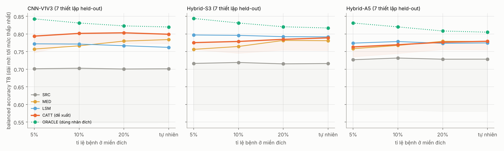
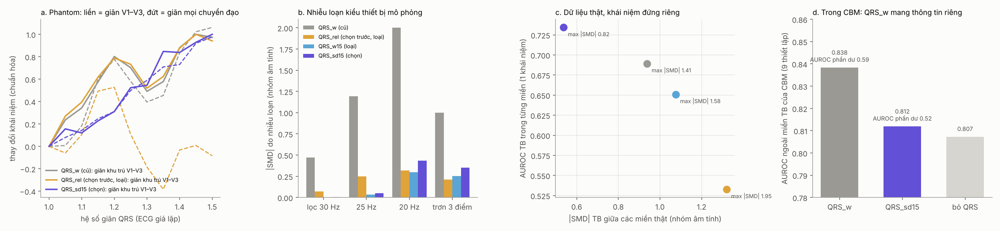

# Bước 5: hiệu chỉnh ngưỡng không cần nhãn (CATT) và thay khái niệm QRS_w

Hai việc còn treo sau bước 4:
- **A.** AUROC ngoài miền đã tốt, nhưng ngưỡng chọn ở miền nguồn bị lệch có hệ thống khi chuyển giữa HUCA và Melo. Có sửa được mà không cần nhãn ở miền mới không, kể cả khi tỉ lệ bệnh thấp như sàng lọc?
- **B.** `QRS_w` là khái niệm nhạy với máy đo nhất. Có thay được bằng một khái niệm bền hơn không?

Cả hai đều có câu trả lời rõ:
- **A làm được.** Phương pháp CATT dùng mô hình khái niệm làm "người gán nhãn yếu" ở miền mới. Balanced accuracy của CNN-V1V3 trên 7 thiết lập held-out tăng từ 0.70 lên 0.80; trường hợp tệ nhất tăng từ 0.55 lên 0.77. Mức tăng ổn định ở mọi tỉ lệ bệnh từ 5% đến tự nhiên.
- **B cho kết quả âm tính nhưng có giá trị.** Ứng viên bền với máy đo nhất (`QRS_sd15`) làm AUROC của CBM giảm ở cả 9/9 thiết lập. `QRS_w` mang thông tin riêng (phổ tần của QRS), và thông tin này *vốn dĩ* phụ thuộc dải thông. Vì vậy cách đúng là giữ `QRS_w` để xếp hạng, còn phần lệch ngưỡng do nó gây ra thì để CATT xử lý.

Toàn bộ kết quả bước 4 được tái lập:
- CBM3-Sign: 0.838.
- CNN-V1V3: 0.870 (bước 4: 0.869; chênh do chạy 1 luồng CPU).
- Hybrid-S3: 0.872 (bước 4: 0.873).

---

## A. Hiệu chỉnh ngưỡng không cần nhãn ở miền đích (`recal_v5.py`)

### Vấn đề
Ở bước 4, ngưỡng Youden chọn trên validation nguồn hỏng đúng ở các cặp HUCA ↔ Melo:
- Claris → HUCA: CNN-V1V3 có độ đặc hiệu 0.10.
- HUCA → Claris: độ nhạy 0.19.

Đây là dịch chuyển của **điểm số** (covariate shift), không phải dịch chuyển tỉ lệ bệnh. Nếu chỉ có tỉ lệ bệnh thay đổi, mật độ điểm theo từng lớp giữ nguyên, nên ngưỡng Youden (tại đó tỉ số hợp lý ≈ 1) cũng giữ nguyên. Vì thế các phương pháp chỉnh theo tỉ lệ bệnh như EM của Saerens hay BBSE không giải quyết được lỗi này.

### Các phương pháp
Mọi phương pháp chỉ dùng nhãn của validation nguồn và điểm không nhãn ở miền đích.

| Tên | Cách làm |
|---|---|
| SRC | Ngưỡng Youden trên validation nguồn, như bước 4. |
| MED | Đưa trung vị/IQR của điểm đích về trung vị/IQR của điểm nguồn. |
| LSM | (đề xuất ban đầu) Coi điểm đích (thang logit) là hỗn hợp 2 lớp có hình dạng lấy từ nguồn, cùng dịch một khoảng δ: g(s) = (1−π)·N(μ0+δ, σ0) + π·N(μ1+δ, σ1). δ và π ước lượng bằng hợp lý cực đại; ngưỡng đích = ngưỡng nguồn + δ. |
| **CATT** | (đề xuất cuối) **Concept-Anchored Threshold Transfer.** Mô hình khái niệm CBM5-Sign gán nhãn giả cho miền đích tại ngưỡng nguồn của chính nó. Ngưỡng của mô hình cần dùng = Youden tính theo nhãn giả. |
| CATT-LSM | Như CATT, nhưng ngưỡng của CBM được dời trước bằng LSM. |
| ORACLE | Youden tính bằng nhãn thật ở miền đích. Đây là cận trên, không dùng được trong thực tế. |

**Cơ sở lý thuyết của CATT** (Menon và cs., ICML 2015):
- Gọi α, β là tỉ lệ nhãn giả sai ở lớp âm và lớp dương.
- Nếu lỗi của nhãn giả độc lập có điều kiện (theo lớp thật) với điểm của mô hình cần hiệu chỉnh, thì chỉ số Youden đo theo nhãn giả bằng J_nhiễu(t) = (1 − α − β)·J(t).
- Vậy ngưỡng tối ưu balanced accuracy không đổi, chỉ cần α + β < 1.
- Hệ quả: **ngưỡng lệch của chính mô hình khái niệm không cần sửa**. Nó chỉ làm hệ số (1 − α − β) nhỏ đi, tức tăng nhiễu do mẫu hữu hạn.

Mô hình khái niệm hợp với vai trò này vì hai lý do:
- Điểm của nó giữ được thang đo khi chuyển miền.
- Nó nhìn ECG qua một "kênh" khác CNN (28 phép đo hình học thay vì tín hiệu thô).

### Quy trình chống "chọn theo kết quả"
- Phương pháp được phát triển **chỉ trên 2 thiết lập HUCA → Claris và HUCA → Mortara**. 7 thiết lập còn lại là held-out.
- Trên tập phát triển, LSM thất bại với CNN. Lý do: điểm CNN ngoài miền bị **nén** chứ không chỉ dịch. Chẳng hạn HUCA → Claris, khoảng cách giữa hai lớp co từ khoảng 1.7 xuống 0.36 logit, dù AUROC vẫn 0.83.
- Cũng trên tập phát triển, CATT ≥ CATT-LSM, đúng như lý thuyết dự đoán. Vì vậy CATT được chọn **trước khi** xem held-out.

### Kết quả trên 7 thiết lập held-out
Số liệu là balanced accuracy trung bình, trong ngoặc là mức thấp nhất trong 7 thiết lập. Tỉ lệ bệnh được hạ bằng cách lấy mẫu con nhóm dương tính, mỗi mức 10 lần rút.

**CNN-V1V3**

| Phương pháp | 5% | 10% | 20% | Tự nhiên |
|---|---|---|---|---|
| SRC | 0.701 (0.548) | 0.703 (0.548) | 0.701 (0.548) | 0.701 (0.548) |
| MED | 0.757 (0.726) | 0.766 (0.746) | 0.780 (0.763) | 0.784 (0.765) |
| LSM | 0.772 (0.716) | 0.771 (0.714) | 0.767 (0.713) | 0.762 (0.701) |
| **CATT** | **0.794 (0.747)** | **0.802 (0.776)** | **0.803 (0.773)** | **0.799 (0.772)** |
| ORACLE | 0.843 (0.812) | 0.831 (0.808) | 0.823 (0.802) | 0.820 (0.802) |

**Hybrid-S3** (CNN-V1V3 + CBM3-Sign)

| Phương pháp | 5% | 10% | 20% | Tự nhiên |
|---|---|---|---|---|
| SRC | 0.717 (0.584) | 0.719 (0.582) | 0.715 (0.581) | 0.716 (0.581) |
| MED | 0.756 (0.725) | 0.765 (0.736) | 0.782 (0.752) | 0.781 (0.726) |
| LSM | 0.797 (0.767) | 0.796 (0.745) | 0.792 (0.753) | 0.792 (0.752) |
| CATT | 0.776 (0.756) | 0.779 (0.745) | 0.785 (0.754) | 0.789 (0.754) |
| CATT-LSM | 0.792 (0.769) | 0.795 (0.762) | 0.799 (0.771) | 0.801 (0.784) |
| ORACLE | 0.844 (0.819) | 0.831 (0.800) | 0.820 (0.796) | 0.817 (0.794) |

**Từng thiết lập** (CNN-V1V3, tỉ lệ bệnh tự nhiên; độ nhạy / độ đặc hiệu):

| Thiết lập | SRC | CATT | Balanced acc SRC → CATT (oracle) |
|---|---|---|---|
| HUCA → Claris (phát triển) | 0.19 / 1.00 | 0.67 / 0.87 | 0.59 → 0.77 (0.78) |
| HUCA → Mortara (phát triển) | 0.16 / 0.99 | 0.63 / 0.85 | 0.57 → 0.74 (0.76) |
| Claris → HUCA | 1.00 / 0.10 | 0.90 / 0.64 | 0.55 → 0.77 (0.81) |
| Mortara → HUCA | 0.96 / 0.19 | 0.77 / 0.82 | 0.57 → 0.79 (0.80) |
| Claris + Mortara → HUCA | 1.00 / 0.10 | 0.86 / 0.73 | 0.55 → 0.80 (0.84) |
| Claris → Mortara | 0.81 / 0.85 | 0.75 / 0.90 | 0.83 → 0.83 (0.85) |
| Mortara → Claris | 0.73 / 0.88 | 0.69 / 0.91 | 0.81 → 0.80 (0.81) |
| HUCA + Mortara → Claris | 0.72 / 0.86 | 0.69 / 0.88 | 0.79 → 0.79 (0.80) |
| HUCA + Claris → Mortara | 0.69 / 0.93 | 0.76 / 0.88 | 0.81 → 0.82 (0.83) |

**Đọc kết quả:**
1. **CATT sửa đúng chỗ hỏng và không làm hại chỗ đã tốt.**
   - Ở cả 5 thiết lập mà ngưỡng nguồn sụp (HUCA ↔ Melo), balanced accuracy tăng từ 0.55–0.59 lên 0.74–0.80, cách oracle 0.01–0.04.
   - Ở 4 thiết lập vốn đã ổn, thay đổi chỉ ±0.01.
   - Đây là tính chất quan trọng nhất để dùng thực tế: không cần biết trước miền mới có lệch hay không.
2. **CATT không phụ thuộc tỉ lệ bệnh.**
   - CATT giữ khoảng 0.80 từ 5% đến tự nhiên.
   - MED thì kém đi ở tỉ lệ bệnh thấp với CNN (0.757 ở 5%) và kém đi ở tỉ lệ bệnh cao với Hybrid trên tập phát triển (0.615). Điều này đúng như dự đoán, vì trung vị trộn cả hai lớp.
3. **Kiểm định trên 7 thiết lập** (Wilcoxon, CNN-V1V3, CATT so với SRC):
   - Mức tăng trung bình +0.09 đến +0.10.
   - Có 3–4 thiết lập tốt hơn, 0–1 thiết lập kém hơn.
   - p = 0.031 ở tỉ lệ bệnh 10% và 20%; p = 0.16–0.22 ở 5% và tự nhiên.
   - Với 7 điểm, lực kiểm định thấp; bằng chứng mạnh nhất là bảng từng thiết lập ở trên.
4. **Với Hybrid, LSM và CATT-LSM nhỉnh hơn CATT khoảng 0.01** trên held-out, trái với tập phát triển. Bài báo nên báo cáo trung thực cả ba, và giải thích bằng tính độc lập: Hybrid chứa chính CBM, nên lỗi của nhãn giả không độc lập với điểm Hybrid. Khi đó giả định của định lý Menon bị vi phạm một phần.
5. **Cấu hình tốt nhất là CNN-V1V3 để xếp hạng + CBM để neo ngưỡng (CATT).**
   - Balanced accuracy 0.80, mức thấp nhất 0.77, ngang hoặc hơn mọi Hybrid.
   - Đây là cách tách vai trò gọn: CNN cho độ phân biệt, mô hình khái niệm cho độ tin cậy về ngưỡng và cho phần giải thích.
6. **Sàng lọc, tỉ lệ bệnh 5%, trung bình cả 9 thiết lập** (CNN-V1V3):
   - SRC: độ nhạy 0.69, độ đặc hiệu 0.65.
   - CATT: độ nhạy 0.82, độ đặc hiệu 0.74.
   - Oracle: độ nhạy 0.82, độ đặc hiệu 0.85.



---

## B. Thay khái niệm QRS_w (`concepts5.py`, `qrs_test5.py`, `qrs_info5.py`)

### Ba ứng viên, thử theo thứ tự

| Ứng viên | Định nghĩa | Kết quả |
|---|---|---|
| `QRS_rel` (chọn trước theo giả thuyết) | log(độ rộng V1–V3 / độ rộng V4–V6): chậm dẫn truyền khu trú ở thất phải; tỉ số triệt tiêu ảnh hưởng thiết bị | **Loại.** Bền với thiết bị nhưng AUROC chỉ 0.52–0.55. Ở cả 3 bộ dữ liệu, Brugada làm QRS rộng ở **mọi** nhóm chuyển đạo (V4–V6 AUROC 0.61–0.72): chậm dẫn truyền lan tỏa, phù hợp cơ chế SCN5A. Lấy tỉ số thì xóa luôn tín hiệu. |
| `QRS_w15` | Độ rộng theo ngưỡng, đo sau khi lọc thông thấp 15 Hz ("sàn dải thông chung") | **Loại.** Sau lọc, độ rộng theo ngưỡng bị đáp ứng xung của bộ lọc chi phối (khoảng 80 ms bất kể QRS thật). Phantom giãn QRS cho Spearman −0.38. |
| `QRS_sd15` | Thời lượng RMS (mô-men bậc hai) của năng lượng đạo hàm V1–V3 sau lọc 15 Hz. Tích chập với bộ lọc **cộng** phương sai của bộ lọc vào phương sai đường bao, nên chênh lệch thời lượng thật được giữ. | **Được chọn** bằng quy tắc không dùng nhãn: trong 8 biến thể, chọn biến thể phantom đơn điệu (ρ ≥ 0.95) và ít nhạy nhất với nhiễu loạn thiết bị mô phỏng. |

### Kiểm chứng không cần bác sĩ
Mọi khái niệm đều bất biến afin theo từng chuyển đạo (sai khác ≤ 5e-7) và có gradient hữu hạn.

| | `QRS_w` (cũ) | `QRS_rel` | `QRS_w15` | `QRS_sd15` |
|---|---|---|---|---|
| Phantom giãn V1–V3 (ρ) | 0.88 | 0.88 | −0.38 | **0.98** |
| Phantom giãn mọi chuyển đạo (ρ) | 0.84 | −0.36 | −0.38 | 1.00 |
| \|SMD\| khi lọc 30 Hz (nhóm âm tính) | 0.47 | 0.07 | 0.00 | **0.00** |
| \|SMD\| khi lọc 20 Hz | 2.00 | 0.32 | 0.30 | 0.43 |
| \|SMD\| khi làm trơn 3 điểm | 1.00 | 0.21 | 0.25 | 0.35 |
| Dịch chuyển miền thật C→M / H→C / H→M | −0.48 / −0.93 / −1.41 | −0.07 / −1.94 / −1.95 | −0.11 / −1.54 / −1.58 | **−0.34 / −0.46 / −0.82** |
| AUROC đứng riêng H / C / M | 0.71 / 0.66 / 0.71 | 0.52 / 0.55 / 0.53 | 0.67 / 0.60 / 0.69 | **0.74 / 0.70 / 0.77** |

Xét từng khái niệm đứng riêng, `QRS_sd15` tốt hơn `QRS_w` ở **mọi** tiêu chí.

### Nhưng trong CBM, `QRS_sd15` lại kém hơn

| Mô hình (9 thiết lập ngoài miền) | AUROC TB | Thấp nhất | So với CBM3-Sign (bootstrap + Holm) |
|---|---|---|---|
| CBM3-Sign (`QRS_w`) | **0.838** | 0.800 | |
| CBM5-Sign (`QRS_sd15`) | 0.812 | 0.769 | **thua 9/9**, Δ −0.026 |
| CBM3n-Sign (bỏ QRS) | 0.807 | 0.755 | **thua 9/9**, Δ −0.031 |
| CBM5-SignAda | 0.818 | 0.783 | |
| Hybrid-S5 so với Hybrid-S3 | 0.857 so với 0.872 | | thua 5, hòa 4 |
| Hybrid-S3 so với CNN-V1V3 | 0.872 so với 0.870 | | hòa 9/9 |

**Vì sao?** (`qrs_info5.py`)
1. **`QRS_sd15` gần như trùng với `r_prime_V1`** (ρ 0.59–0.71). Sau khi hồi quy loại phần do 27 khái niệm khác giải thích, AUROC của phần dư chỉ còn 0.49–0.55.
2. **`QRS_w` mang thông tin riêng.** Tương quan lớn nhất với khái niệm khác chỉ 0.26–0.36, AUROC phần dư 0.58–0.60. Thêm `QRS_w` vào hồi quy logistic trên khái niệm cố định làm AUROC chéo miền tăng 0.014–0.058 ở cả 6 cặp.
3. **Thông tin đó là phổ tần của QRS.**
   - Giả thuyết "QRS phân mảnh" bị bác bỏ, và kết quả ngược lại: ECG Brugada có **ít** năng lượng trên 15 Hz hơn trong cửa sổ QRS và đầu ST (AUROC theo chiều nghịch 0.63–0.79).
   - `QRS_w` tương quan âm với tỉ lệ này (ρ ≈ −0.5).
   - Tính chất phổ tần này tự nó phụ thuộc dải thông: nhóm âm tính có tỉ lệ năng lượng tần số cao 0.18 ở HUCA so với 0.25 ở Melo.
   - Vì vậy làm khái niệm bền với thiết bị thì cũng xóa thông tin chẩn đoán. Hai thứ không tách được ở mức khái niệm.
   - Lưu ý: cửa sổ đo gồm cả đầu đoạn ST, nên một phần tín hiệu có thể đến từ ST chênh, chưa tách được hoàn toàn.
4. **Kết luận cho thiết kế:** "nhạy với thiết bị" không có nghĩa là "có hại cho xếp hạng".
   - Dịch chuyển của `QRS_w` chủ yếu làm **lệch ngưỡng**, không làm hỏng thứ tự xếp hạng trong từng miền.
   - Vì vậy giữ `QRS_w` và sửa ngưỡng bằng CATT tốt hơn thay khái niệm. Phần A và B khép lại thành một câu chuyện.
   - `QRS_sd15` vẫn đáng giữ trong phụ lục như một khái niệm bền thiết bị đã kiểm chứng, nhưng không thêm thông tin.



---

## So sánh với y văn

Không có nghiên cứu nào dùng cùng giao thức, nên bảng dưới chỉ để định vị. Các con số không so sánh trực tiếp được với nhau.

| Nghiên cứu | Dữ liệu | Đánh giá | AUROC | Độ nhạy / độ đặc hiệu |
|---|---|---|---|---|
| Melo và cs. 2023, PNAS Nexus | Claris 1154 → Mortara 370 (khác máy, cùng nhóm nghiên cứu); 83% dương tính lộ ra nhờ ajmaline | Huấn luyện toàn bộ Claris, ensemble 7 mô hình, 200 Hz | Mortara **0.934**; Claris LOOCV 0.912; bác sĩ 0.722 | 0.80 / 0.94 |
| **Bài này**, Claris → Mortara | Cùng dữ liệu, nhãn tái tạo, 100 Hz, 85% Claris để huấn luyện | Ngoài miền | CNN-V1V3 0.901, Hybrid-S3 0.902 | CATT 0.75 / 0.90 |
| Liu và cs. 2022, Can J Cardiol | Type 1 so với ECG không Brugada chọn ngẫu nhiên, 1:1 | Nội bộ / ngoài (Đài Loan, Nhật) | 0.96 / 0.89 | 0.86 / 0.90 (ngoài) |
| Călburean và cs. 2024, JAHA | 1188 bệnh nhân test ajmaline | Nội bộ | 0.945 (nhận diện trên ECG ajmaline); 0.805 (dự đoán từ ECG nền) | — |
| An và cs. 2026, CinC | **HUCA**, transformer | Trong HUCA, xoay vòng 10 lần | 0.867 | 0.67 / 0.92 |
| Dei Rossi và cs. 2026, arXiv | BrSwiss (riêng tư) + **HUCA**, 9 mô hình nền tảng ECG | Trong HUCA / chuyển thẳng BrSwiss → HUCA | 0.906 / **0.45–0.72** ("gần ngẫu nhiên") | — |
| **Bài này**, Melo → HUCA | Không thấy HUCA khi huấn luyện | Ngoài miền | Claris + Mortara → HUCA: CNN-V1V3 0.903, **Hybrid-S3 0.916**; Claris → HUCA: 0.872 / 0.903 | CATT 0.86 / 0.73 |

**Đọc bảng:**
- **Chuyển sang HUCA:** mô hình của bài này chưa từng thấy HUCA mà vẫn đạt 0.90–0.92. Con số này cao hơn kết quả huấn luyện ngay trên HUCA của An và cs. (0.867), ngang Dei Rossi và cs. (0.906), và vượt xa mức chuyển thẳng 0.45–0.72 mà Dei Rossi báo cáo. Nguồn dữ liệu khác nhau (Melo so với BrSwiss), nên chưa kết luận được là phương pháp tốt hơn. Nhưng điều này cho thấy chuẩn hóa dữ liệu + chỉ dùng V1–V3 là yếu tố quyết định, đúng với nhận định "khớp miền dữ liệu quan trọng hơn tiền huấn luyện" của chính Dei Rossi và cs.
- **Claris → Mortara:** thấp hơn Melo và cs. khoảng 0.03 (0.90 so với 0.93). Lý do: 100 Hz thay vì 200 Hz, 85% dữ liệu huấn luyện, nhãn tái tạo, mô hình nhỏ. Kết quả vẫn trong vùng hợp lý.
- **Điều chưa ai làm:** đánh giá chéo cả 3 bộ dữ liệu công khai, phát hiện shortcut ngoài V1–V3, lớp khái niệm khả vi được kiểm chứng bằng chú thích của bác sĩ trên LUDB, và hiệu chỉnh ngưỡng không cần nhãn. Mình chưa tìm thấy bài nào làm những việc này cho Brugada.

---

## Nghiên cứu đã thành hình chưa?

### Đã đủ chắc để làm xương sống bài báo
1. **Bộ benchmark chéo miền đầu tiên cho Brugada trên dữ liệu công khai:** 3 miền, 9 thiết lập ngoài miền, giao thức thống kê chặt (3 seed, bootstrap ghép cặp, Holm).
2. **Shortcut ngoài V1–V3:** chỉ dùng V1–V3 tăng AUROC ngoài miền ở 3 kiến trúc (tuyến tính, CNN, ResNet; +0.02 đến +0.06; 6–8/9 thiết lập).
3. **Lớp khái niệm Brugada khả vi, kiểm chứng không cần bác sĩ:**
   - Phantom.
   - LUDB: điểm J lệch −0.6 ms, SD 9.8 ms so với chú thích của bác sĩ tim mạch, trong dung sai CSE.
   - Tham số mốc học được tự dời về J + 20 ms, một kết quả giải thích được.
4. **CATT:** hiệu chỉnh ngưỡng không cần nhãn, có cơ sở lý thuyết, sửa được lỗi thực tế lớn nhất (độ đặc hiệu 0.10 → 0.73) mà không làm hại chỗ đã tốt. Đây là đóng góp phương pháp rõ nhất, và **cho mô hình khái niệm một vai trò không thay thế được** ngay cả khi CNN xếp hạng tốt hơn.
5. **Các kết quả âm tính có giải thích:** Ada phụ thuộc tỉ lệ bệnh; `QRS_rel` bác bỏ giả thuyết chậm dẫn truyền khu trú; đánh đổi giữa độ bền thiết bị và thông tin của `QRS_w`.

### So với dự đoán ban đầu

| Giả thuyết ban đầu | Kết quả |
|---|---|
| Mô hình khái niệm chuyển miền tốt hơn CNN | **Một phần.** Hơn CNN 9 chuyển đạo, nhưng **kém CNN-V1V3** (0.838 so với 0.870). Hybrid chỉ hòa CNN-V1V3 (9/9 hòa). Không nên viết "CBM tổng quát hóa tốt hơn". |
| Có shortcut ngoài V1–V3 | **Đúng, mạnh hơn dự kiến.** Đúng trên 3 kiến trúc. |
| Điểm J khả vi khớp với bác sĩ | **Đúng.** |
| Chuẩn hóa theo miền (Ada) giúp chuyển miền | **Chỉ khi tỉ lệ bệnh ≥ 20%.** Không dùng được cho sàng lọc. |
| Thay QRS_w bằng khái niệm bền hơn sẽ tốt hơn | **Sai.** Nhưng lý do sai cho ra một phát hiện có giá trị. |
| Có thể sửa ngưỡng mà không cần nhãn | **Đúng.** CATT đạt cách oracle 0.02–0.05. |

### Điểm yếu reviewer chắc chắn sẽ hỏi
1. **Nhãn Melo được tái tạo** từ đường ROC. Khớp đúng TP/TN đã công bố, nhưng vẫn là tái tạo. Nên gửi email xin nhãn gốc của nhóm Melo (dữ liệu trên Dryad, tác giả liên hệ được).
2. **Định nghĩa nhãn khác nhau giữa các miền.** Ở Melo, 83% dương tính lộ ra nhờ ajmaline (Brugada "ẩn" trên ECG nền); HUCA ghi nhãn theo "dạng ECG Brugada" do chuyên gia đọc. Một phần cái gọi là "dịch chuyển miền" là dịch chuyển định nghĩa nhãn. Đây vừa là điểm yếu, vừa là lời giải thích hợp lý cho lệch ngưỡng HUCA ↔ Melo. Bài báo phải nêu rõ.
3. **Cỡ mẫu nhỏ:** HUCA chỉ có 73 dương tính; validation nguồn khi huấn luyện trên HUCA chỉ 11 dương tính. Kiểm định Wilcoxon trên 7 thiết lập có lực thấp.
4. **Không có mô hình khái niệm nào thắng CNN-V1V3 về AUROC.** Câu chuyện phải xoay sang: khái niệm cho kiểm chứng điểm J + neo ngưỡng (CATT) + giải thích, chứ không phải độ chính xác.
5. **Bất đối xứng tiền xử lý:** HUCA là nhịp trung vị do mình tính ở 100 Hz; Melo là nhịp trung vị do máy tính. Cần thêm một phân tích độ nhạy.

### Nên nhắm nơi nào
- **Thực tế nhất: tạp chí Q1** về kỹ thuật y sinh hoặc tin học y tế (ví dụ IEEE JBHI, Computers in Biology and Medicine, Biomedical Signal Processing and Control).
  - Thông điệp: "Đánh giá chéo miền + shortcut V1–V3 + lớp khái niệm kiểm chứng không cần bác sĩ + CATT".
  - Lượng kết quả hiện tại gần đủ cho một bài loại này.
- **Hội nghị A/A\*** (NeurIPS, ICML, AAAI): khó với dữ liệu hiện tại.
  - Reviewer ML sẽ đòi CATT được kiểm chứng trên nhiều bài toán, nhiều bộ dữ liệu ngoài Brugada, và so với các phương pháp ước lượng hiệu năng không nhãn (ATC, DoC…).
  - Nếu muốn đi hướng này, CATT phải thành đóng góp chính và thử thêm trên PTB-XL / CPSC (ví dụ RBBB) để chứng minh tính tổng quát.
- **MICCAI** (CORE A) là lựa chọn trung gian nếu viết gọn quanh CATT + lớp khái niệm. Nhưng tín hiệu 1D ít được ưu tiên ở đó.

### Việc nên làm tiếp, theo thứ tự ưu tiên
1. Xin nhãn gốc của Melo (email), hoặc ít nhất làm phân tích độ nhạy với nhãn tái tạo.
2. Phân tích độ nhạy tiền xử lý: tính lại nhịp trung vị HUCA ở tần số cao hơn hoặc theo cách của máy, kiểm tra lệch ngưỡng HUCA ↔ Melo còn không.
3. So CATT với các phương pháp không nhãn trong y văn ML (ATC; dùng CNN 9 chuyển đạo làm người gán nhãn thay cho CBM, để chứng minh vai trò của *khái niệm*).
4. Viết bản thảo: hình 1 sơ đồ; hình 2 V1–V3 trên 3 kiến trúc; hình 3 LUDB; hình 4 CATT.

---

## Tệp

| Tệp | Nội dung |
|---|---|
| `concepts5.py` | Lớp khái niệm v5: chế độ `abs` (QRS_w), `rel`, `lp15`, `sd15` |
| `qrs_test5.py` → `qrs_test5.json` | Phantom, bất biến, nhiễu loạn thiết bị, dịch chuyển miền thật |
| `qrs_info5.py` → `qrs_info5.json` | Thông tin riêng, hồi quy logistic chéo miền, phổ tần |
| `compare_v5.py` → `v5_raw_0.jsonl`, `v5_raw_1.jsonl` | 9 thiết lập × 3 seed; lưu điểm validation và điểm miền đích |
| `recal_v5.py` → `recal_raw.csv` | 6 phương pháp ngưỡng × 4 mức tỉ lệ bệnh |
| `analyze_v5.py` | Bảng và hình |
| `v5_auroc.csv`, `v5_paired_holm.csv`, `v5_paired_summary.csv`, `v5_qrs_sign_gate.csv` | AUROC và so sánh cặp |
| `recal_summary.csv`, `recal_heldout_tests.csv`, `recal_screening5.csv`, `recal_per_setting_natural.csv` | Kết quả hiệu chỉnh ngưỡng |
| `fig_v5_recal.png`, `fig_v5_qrs.png` | Hình |

Chạy lại (khoảng 1.5 giờ trên 2 CPU, chủ yếu ở `compare_v5`):
```
python qrs_test5.py <harmonized> .
python qrs_info5.py <harmonized> .
python compare_v5.py <harmonized> . 0 2  &  python compare_v5.py <harmonized> . 1 2
python recal_v5.py . <harmonized>
python analyze_v5.py . <harmonized>
```
Cần các thư mục `../concepts_v4` và `../concepts_v2` nằm cạnh thư mục này.

**Nguồn đã tra cứu:**
- [Melo và cs. 2023, PNAS Nexus](https://iris.unisr.it/retrieve/58843688-2474-4757-a7b7-a14fccdfccb3/pgad327.pdf)
- [Liu và cs. 2022, Can J Cardiol](https://scholar.nycu.edu.tw/en/publications/a-deep-learningenabled-electrocardiogram-model-for-the-identifica/)
- [Călburean và cs. 2024, JAHA](https://doaj.org/article/46260e4e9a2e4e71b5c2609a5d3c3113)
- [An và cs. 2026, CinC](https://cinc.org/2026/Program/accepted/545.html)
- [Dei Rossi và cs. 2026, arXiv 2607.03009](https://arxiv.org/abs/2607.03009)
- [Brugada-HUCA, PhysioNet](https://physionet.org/content/brugada-huca/1.0.0/)
- [Menon và cs. 2015, ICML](https://proceedings.mlr.press/v37/menon15.html)
