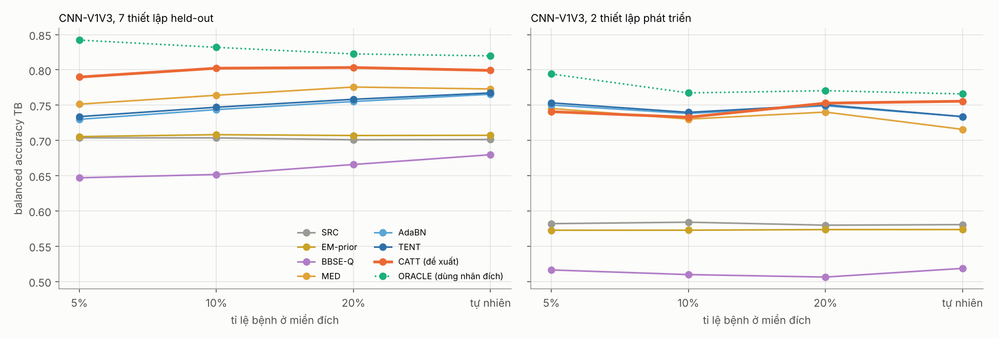
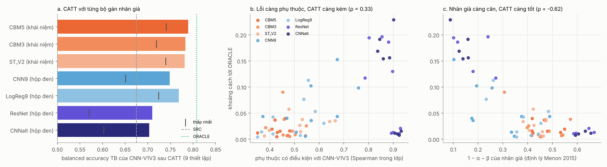

# Bước 6: CATT so với các phương pháp không nhãn trong y văn, và khái niệm có thật sự cần không?

Hai câu hỏi reviewer chắc chắn sẽ đặt ra cho CATT (bước 5):
1. **CATT có tốt hơn các phương pháp không nhãn đã biết không?** Hai họ phương pháp chính: chỉnh theo tỉ lệ bệnh (EM của Saerens, BBSE) và thích nghi lúc test (AdaBN, TENT).
2. **Lợi ích đến từ *khái niệm*, hay chỉ từ việc có "một mô hình thứ hai"?** Nếu thay mô hình khái niệm bằng một CNN hay ResNet hộp đen làm bộ gán nhãn giả mà vẫn tốt như vậy, thì phần khái niệm không cần thiết.

**Trả lời ngắn:**
- **CATT tốt hơn mọi phương pháp so sánh trên 7 thiết lập held-out**, cả trung bình lẫn trường hợp tệ nhất. Ở tỉ lệ bệnh tự nhiên, CATT thắng AdaBN, TENT (Wilcoxon p = 0.016) và MED (p = 0.047). EM và BBSE gần như không sửa được gì.
- **Khái niệm là thứ quyết định.** Ba bộ gán nhãn dựa trên khái niệm đều cho CATT tốt nhất (0.78–0.79). Bốn bộ hộp đen kém hơn rõ (0.70–0.77), kể cả hai bộ có AUROC *cao nhất* (ResNet, CNN-V1V3 khác seed: 0.86–0.87).
- **Cơ chế đúng như định lý Menon dự đoán.** CATT tốt khi lỗi của nhãn giả *không phụ thuộc* điểm của CNN và nhãn giả *cân* (1 − α − β lớn). Hai đại lượng này gần như trực giao với nhau và cùng giải thích 82% phương sai của khoảng cách tới oracle.

Mô hình đích là CNN-V1V3 (ensemble 3 seed), huấn luyện lại và trùng điểm của bước 5 (chênh tối đa 5e-7).

---

## 1. Các phương pháp so sánh (`compare_v6.py`)

Mọi phương pháp chỉ dùng nhãn của validation nguồn và dữ liệu không nhãn ở miền đích. Siêu tham số của TENT được chọn trước, không tinh chỉnh.

| Tên | Họ | Cách làm |
|---|---|---|
| SRC | — | Ngưỡng Youden trên validation nguồn |
| EM-prior | Chỉnh theo tỉ lệ bệnh | Saerens và cs. 2002: hiệu chuẩn Platt trên nguồn, EM ước lượng tỉ lệ bệnh π̂ ở đích, ngưỡng tối ưu balanced accuracy trên hậu nghiệm đã chỉnh |
| BBSE-Q | Chỉnh theo tỉ lệ bệnh | Lipton và cs. 2018: ước lượng π̂ từ ma trận nhầm lẫn nguồn, đặt ngưỡng tại phân vị (1 − π̂) của điểm đích |
| MED | Khớp phân bố điểm | Đưa trung vị/IQR của điểm đích về nguồn |
| AdaBN | Thích nghi lúc test | Li và cs. 2016; Schneider và cs. 2020: thay thống kê BatchNorm bằng thống kê của lô đích |
| TENT | Thích nghi lúc test | Wang và cs. 2021: AdaBN + cực tiểu entropy, cập nhật tham số afin của BatchNorm (Adam, lr 1e-3, 10 bước) |
| **CATT** | Đề xuất | Nhãn giả từ mô hình khái niệm CBM5-Sign, ngưỡng Youden theo nhãn giả |
| AdaBN+CATT | Kết hợp | AdaBN rồi đặt ngưỡng bằng CATT |
| ORACLE | Cận trên | Youden dùng nhãn đích |

AdaBN và TENT được tính lại cho *từng* lần rút mẫu ở mỗi mức tỉ lệ bệnh, vì chúng dùng thống kê của chính lô dữ liệu đích.

## 2. Kết quả: CATT so với y văn

Số liệu là balanced accuracy của CNN-V1V3, trung bình trên 7 thiết lập held-out, trong ngoặc là mức thấp nhất.

| Phương pháp | 5% | 10% | 20% | Tự nhiên |
|---|---|---|---|---|
| SRC | 0.704 (0.548) | 0.704 (0.548) | 0.701 (0.548) | 0.701 (0.548) |
| EM-prior | 0.705 (0.550) | 0.708 (0.551) | 0.707 (0.549) | 0.707 (0.550) |
| BBSE-Q | 0.647 (0.502) | 0.652 (0.502) | 0.666 (0.502) | 0.680 (0.502) |
| MED | 0.751 (0.729) | 0.764 (0.728) | 0.776 (0.723) | 0.773 (0.713) |
| AdaBN | 0.730 (0.687) | 0.744 (0.698) | 0.755 (0.714) | 0.765 (0.714) |
| TENT | 0.734 (0.693) | 0.747 (0.701) | 0.758 (0.716) | 0.767 (0.715) |
| **CATT** | **0.790 (0.750)** | **0.802 (0.767)** | **0.803 (0.772)** | **0.799 (0.772)** |
| AdaBN+CATT | 0.794 (0.760) | 0.800 (0.767) | 0.802 (0.777) | 0.801 (0.776) |
| ORACLE | 0.842 (0.814) | 0.832 (0.814) | 0.823 (0.804) | 0.820 (0.802) |

**Kiểm định Wilcoxon trên 7 thiết lập held-out** (CATT trừ phương pháp so sánh):

| So với | Tỉ lệ 5%: Δ, thắng/thua, p | Tự nhiên: Δ, thắng/thua, p |
|---|---|---|
| SRC | +0.086, 3/2, 0.47 | +0.098, 4/0, 0.22 |
| EM-prior | +0.084, 3/1, 0.22 | +0.092, 3/0, 0.38 |
| BBSE-Q | +0.143, 6/1, **0.031** | +0.120, 4/1, 0.11 |
| MED | +0.038, 6/0, **0.031** | +0.026, 5/0, **0.047** |
| AdaBN | +0.060, 6/1, **0.031** | +0.034, 5/0, **0.016** |
| TENT | +0.056, 6/1, **0.047** | +0.032, 5/0, **0.016** |

So với SRC và EM-prior thì p lớn hơn, dù Δ lớn nhất. Lý do: hai phương pháp này *không đổi gì* ở các thiết lập vốn đã ổn, nên chỉ có 3–4 thiết lập khác biệt.

**Từng thiết lập** (tỉ lệ tự nhiên, balanced accuracy):

| Thiết lập | SRC | EM-prior | MED | AdaBN | TENT | **CATT** | ORACLE |
|---|---|---|---|---|---|---|---|
| HUCA → Claris (phát triển) | 0.590 | 0.582 | 0.718 | 0.739 | 0.738 | **0.770** | 0.775 |
| HUCA → Mortara (phát triển) | 0.571 | 0.565 | 0.714 | 0.728 | 0.729 | **0.741** | 0.757 |
| Claris → HUCA | 0.549 | 0.550 | **0.777** | 0.714 | 0.715 | 0.772 | 0.809 |
| Claris → Mortara | 0.829 | 0.835 | 0.816 | 0.795 | 0.799 | 0.826 | 0.846 |
| Mortara → HUCA | 0.575 | 0.574 | 0.713 | 0.755 | 0.757 | **0.791** | 0.803 |
| Mortara → Claris | 0.806 | 0.800 | 0.748 | 0.787 | 0.789 | 0.799 | 0.812 |
| Claris + Mortara → HUCA | 0.548 | 0.578 | 0.771 | 0.715 | 0.717 | **0.797** | 0.837 |
| HUCA + Mortara → Claris | 0.793 | 0.796 | 0.766 | 0.779 | 0.782 | 0.787 | 0.802 |
| HUCA + Claris → Mortara | 0.808 | 0.818 | 0.820 | 0.814 | 0.812 | 0.823 | 0.830 |

**Đọc kết quả:**
1. **Họ chỉnh theo tỉ lệ bệnh (EM, BBSE) thất bại, đúng như lý thuyết đã nêu ở bước 5.**
   - Lỗi ở đây là dịch chuyển của *điểm*, không phải của tỉ lệ bệnh.
   - Ước lượng tỉ lệ bệnh của chúng sai lớn: π̂ ≈ 0.36–0.42 trong khi thật là 0.05–0.20.
   - BBSE còn kém hơn SRC, vì nó tin vào ma trận nhầm lẫn của nguồn, mà chính ma trận này đã không còn đúng ở đích.
2. **AdaBN và TENT có giúp, nhưng ít hơn CATT và phụ thuộc tỉ lệ bệnh.**
   - Chúng giúp: 0.70 → 0.77 ở tỉ lệ tự nhiên.
   - Nhưng còn 0.73 ở tỉ lệ 5%, vì thống kê BatchNorm của lô đích bị thành phần lớp chi phối.
   - Hai phương pháp này gần như không đổi AUROC (0.865 → 0.866). Chúng chỉ dời điểm, mà dời chưa đủ: ở Claris → HUCA, độ đặc hiệu vẫn thấp.
   - TENT không hơn AdaBN: với bài toán nhị phân và mô hình nhỏ, phần cực tiểu entropy gần như không thêm gì.
3. **MED là đối thủ mạnh nhất**, và thắng CATT ở đúng một thiết lập (Claris → HUCA: 0.777 so với 0.772). Nhưng MED phụ thuộc tỉ lệ bệnh: mức thấp nhất là 0.713 ở tỉ lệ tự nhiên, và nó kém đi ở các thiết lập vốn ổn (Mortara → Claris 0.748). CATT không có hai nhược điểm này.
4. **Trên 2 thiết lập phát triển**, CATT, AdaBN, TENT và MED gần như ngang nhau (0.73–0.76). Lợi thế của CATT chỉ lộ ra ở held-out, chủ yếu ở hướng Melo → HUCA.
5. **AdaBN+CATT không tốt hơn CATT** (Δ ≤ 0.004, không ý nghĩa thống kê). Hai cơ chế sửa cùng một lỗi, nên không cộng dồn.
6. **Sàng lọc, tỉ lệ bệnh 5%, held-out:**
   - CATT: độ nhạy 0.83, độ đặc hiệu 0.75.
   - AdaBN/TENT: 0.90 / 0.56–0.57.
   - MED: 0.88 / 0.63.
   - SRC: 0.85 / 0.56.
   - Oracle: 0.84 / 0.85.

   Các phương pháp khác giữ độ nhạy cao nhờ hạ độ đặc hiệu, nghĩa là quá nhiều báo động giả khi sàng lọc. CATT cân bằng hơn hẳn.



---

## 3. Khái niệm có thật sự cần không? Thay bộ gán nhãn giả

Mỗi bộ gán nhãn dùng ngưỡng Youden trên validation nguồn của chính nó, rồi CATT chọn ngưỡng của CNN-V1V3 theo nhãn giả đó. Bảng dưới là trung bình 9 thiết lập, tỉ lệ bệnh tự nhiên (trừ cột 5%).

| Bộ gán nhãn | Loại | AUROC của nó | α | β | 1 − α − β | Phụ thuộc với CNN | CATT TB | CATT ở 5% | CATT thấp nhất | CATT held-out |
|---|---|---|---|---|---|---|---|---|---|---|
| **CBM5** (28 khái niệm, QRS_sd15) | khái niệm | 0.808 | 0.24 | 0.30 | **0.46** | **0.43** | **0.790** | **0.779** | **0.741** | **0.799** |
| CBM3 (28 khái niệm, QRS_w) | khái niệm | 0.835 | 0.27 | 0.27 | 0.46 | 0.47 | 0.783 | 0.769 | 0.719 | 0.793 |
| ST_V2 (1 đặc trưng ST ở V2, không học) | khái niệm | 0.808 | 0.20 | 0.36 | 0.44 | 0.52 | 0.782 | 0.778 | 0.740 | 0.789 |
| LogReg9 (tuyến tính, tín hiệu thô 9 chuyển đạo) | hộp đen | 0.801 | 0.36 | 0.26 | 0.38 | 0.49 | 0.769 | 0.759 | 0.724 | 0.772 |
| CNN9 (CNN 9 chuyển đạo) | hộp đen | 0.812 | 0.34 | 0.39 | 0.27 | 0.57 | 0.748 | 0.742 | 0.651 | 0.754 |
| ResNet (ResNet1D V1–V3) | hộp đen | 0.861 | 0.31 | 0.31 | 0.38 | 0.87 | 0.710 | 0.714 | 0.570 | 0.739 |
| CNNalt (CNN-V1V3, seed 3–5) | hộp đen | **0.868** | 0.35 | 0.30 | 0.35 | **0.89** | 0.703 | 0.699 | 0.602 | 0.729 |

Ghi chú về các cột:
- α = tỉ lệ âm tính bị gán dương; β = tỉ lệ dương tính bị gán âm.
- "Phụ thuộc với CNN" = Spearman giữa điểm bộ gán nhãn và điểm CNN-V1V3, tính *trong* từng lớp thật.
- Để so sánh: SRC đạt khoảng 0.67, ORACLE khoảng 0.81 (trung bình 9 thiết lập, tỉ lệ tự nhiên).

**Kiểm định held-out** (CATT với CBM5 trừ CATT với bộ khác):
- So với CNN9: +0.048 ở tỉ lệ 5% (thắng 6, thua 0, p = 0.016); +0.045 ở tỉ lệ tự nhiên (p = 0.078).
- So với ResNet: +0.052 / +0.060.
- So với CNNalt: +0.063 / +0.070.
- So với LogReg9: +0.021 / +0.027.
- So với hai bộ khái niệm khác (CBM3, ST_V2): chênh 0.004–0.017, không có ý nghĩa thống kê.

**Cơ chế** (63 điểm = 9 thiết lập × 7 bộ gán nhãn, `v6_mechanism.json`):
- Khoảng cách tới oracle tương quan với độ phụ thuộc (Spearman ρ = +0.33, p = 0.008) và với 1 − α − β (ρ = −0.62, p = 5e-8).
- Hai đại lượng này gần như trực giao (ρ = −0.02). Hồi quy chuẩn hóa: khoảng cách = +0.026·(phụ thuộc) − 0.046·(1 − α − β), R² = 0.82.
- Đây đúng là hai điều kiện trong định lý Menon 2015: nhãn giả phải độc lập có điều kiện với điểm của mô hình đích, và α + β phải nhỏ (hệ số 1 − α − β càng lớn, nhiễu mẫu hữu hạn càng nhỏ).
- Thêm AUROC của bộ gán nhãn vào hồi quy chỉ tăng R² lên 0.90, và hệ số lại *dương*. Nghĩa là **bộ gán nhãn chính xác hơn không làm CATT tốt hơn**. Các bộ hộp đen chính xác nhất là những bộ giống CNN nhất, nên mắc cùng lỗi với CNN.

**Đọc kết quả:**
1. **Hai bộ gán nhãn có AUROC cao nhất lại cho CATT kém nhất.** ResNet và CNNalt nhìn cùng đầu vào V1–V3 với CNN, nên phụ thuộc với CNN tới 0.87–0.89, và dịch chuyển miền làm chúng hỏng ngưỡng *cùng hướng* với CNN. Hình b cho thấy rõ: các điểm của chúng chia hai cụm.
   - Ở các cặp HUCA ↔ Melo, khoảng cách tới oracle là 0.15–0.23: nhãn giả mang đúng lỗi cần sửa.
   - Ở các cặp trong nội bộ Melo thì không có gì để sửa.
2. **Bộ hộp đen dùng đầu vào khác (CNN9, LogReg9) ở mức giữa.** Phụ thuộc thấp hơn (0.49–0.57), nhưng ngưỡng nguồn của chính chúng chuyển miền kém. Đặc biệt CNN9 có 1 − α − β = 0.27 vì dùng cả chuyển đạo chi, đúng phần có shortcut (bước 4).
3. **Mọi bộ dựa trên khái niệm đều tốt, kể cả quy tắc 1 đặc trưng không học (ST_V2).** Phép đo sinh lý cho một "góc nhìn" khác hẳn CNN về cùng một ECG: lỗi ít phụ thuộc (0.43–0.52), và ngưỡng ít lệch khi chuyển miền (1 − α − β ≈ 0.44–0.46).
   - Đây chính là điều kiện "hai góc nhìn độc lập có điều kiện" của co-training (Blum và Mitchell 1998), áp dụng vào việc đặt ngưỡng.
4. **Điều cần viết trung thực:** CATT cần một *góc nhìn khái niệm*, chứ không nhất thiết cần cả mô hình khái niệm khả vi.
   - ST_V2 kém CBM5 chỉ 0.004–0.010 về trung bình và gần ngang ở mức thấp nhất.
   - CBM5 tốt nhất về trung bình, ở tỉ lệ 5% và ở mức thấp nhất, kèm thêm khả năng giải thích và điểm J đã kiểm chứng. Nhưng lợi thế so với một quy tắc lâm sàng đơn giản không có ý nghĩa thống kê.
   - Theo một nghĩa, đây lại là điểm mạnh cho bài báo: CATT dùng được với bất kỳ phép đo sinh lý đáng tin cậy nào.



---

## 4. Ý nghĩa cho bài báo

- **Câu chuyện chính giờ đã khép kín:**
  - CNN chỉ dùng V1–V3 cho độ phân biệt tốt nhất ngoài miền (bước 4).
  - Nhưng ngưỡng của nó sụp khi chuyển giữa các bệnh viện, và các phương pháp không nhãn kinh điển (EM, BBSE, AdaBN, TENT) không sửa đủ.
  - Một góc nhìn khái niệm sinh lý, có lỗi gần độc lập với CNN, sửa được ngưỡng đó mà không cần nhãn (CATT), có cơ sở lý thuyết (Menon 2015) và cơ chế được kiểm chứng định lượng (R² = 0.82).
  - Lớp khái niệm khả vi được kiểm chứng trên LUDB là phiên bản tốt nhất và diễn giải được của góc nhìn đó.
- **Câu trả lời cho reviewer "khái niệm có cần không":** có. Thay bằng mô hình hộp đen, dù chính xác hơn, làm CATT kém đi 0.02–0.09 và mức thấp nhất rơi xuống 0.57–0.72. Cơ chế giải thích được vì sao.
- **Điểm yếu còn lại:**
  - Chỉ 3 miền, 7 thiết lập held-out, nên lực thống kê thấp.
  - Lợi thế của CATT tập trung ở các cặp HUCA ↔ Melo.
  - Cần nói rõ là CATT không thay được ORACLE: vẫn còn khoảng cách 0.02–0.05.
- **Nếu nhắm hội nghị ML:** bước tiếp theo là thử CATT trên một bài toán khác có cùng cấu trúc "mô hình sâu + phép đo sinh lý". Ví dụ RBBB hoặc LVH trên PTB-XL so với CPSC/Georgia, dùng tiêu chí điện áp hay độ rộng QRS làm bộ gán nhãn. Điều này sẽ chứng minh CATT tổng quát, không chỉ cho Brugada.

---

## Tệp

| Tệp | Nội dung |
|---|---|
| `compare_v6.py` → `v6_raw_0.jsonl`, `v6_raw_1.jsonl` | 27 lượt (9 thiết lập × 3 seed): mọi phương pháp × 4 mức tỉ lệ bệnh × 10 lần rút; số đo cơ chế từng bộ gán nhãn |
| `arch_v4_lib.py` | ResNet1D tách từ bước 4 (giữ nguyên) |
| `analyze_v6.py` | Bảng, kiểm định, hình |
| `v6_summary.csv`, `v6_tests_heldout.csv`, `v6_per_setting_natural.csv` | So sánh phương pháp |
| `v6_labelers.csv`, `v6_mechanism.json`, `v6_mechanism_points.csv` | Bộ gán nhãn và cơ chế |
| `v6_auroc_adapt.csv` | AUROC trước/sau AdaBN, TENT |
| `fig_v6_methods.png`, `fig_v6_labelers.png` | Hình |

Chạy lại (khoảng 45 phút trên 2 CPU; cần `../concepts_v5` có `v5_raw_*.jsonl` và `../concepts_v4`):
```
python compare_v6.py <harmonized> ../concepts_v5 . 0 2  &  python compare_v6.py <harmonized> ../concepts_v5 . 1 2
python analyze_v6.py .
```

**Tài liệu tham khảo:**
- [Saerens và cs. 2002, Neural Computation](https://mlanthology.org/neco/2002/saerens2002neco-adjusting)
- [Lipton và cs. 2018, ICML (BBSE)](https://proceedings.mlr.press/v80/lipton18a.html)
- [Li và cs. 2016 (AdaBN)](https://arxiv.org/pdf/1603.04779)
- [Schneider và cs. 2020, NeurIPS](https://papers.nips.cc/paper/2020/hash/85690f81aadc1749175c187784afc9ee-Abstract.html)
- [Wang và cs. 2021, ICLR (TENT)](https://mlanthology.org/iclr/2021/wang2021iclr-tent/)
- [Menon và cs. 2015, ICML](https://proceedings.mlr.press/v37/menon15.html)
- [Blum và Mitchell 1998 (co-training)](https://publications.ri.cmu.edu/combining-labeled-and-unlabeled-data-with-co-training)
